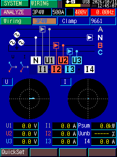
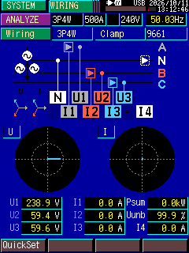

# hioki3197-linux

An unofficial Linux USB client for the **HIOKI 3197 Power Quality Analyzer**.

HIOKI only ships Windows tooling for this instrument (a native DLL + kernel
driver, "3197Communicator"/"3197DataViewer"). This project talks to the
device directly over USB from Linux with plain Python, no Windows VM and
no vendor driver required -- just a short udev rule for USB permissions.

It can:
- Grab a **live screenshot** of the instrument's display (`:BCOPY?`), which
  shows whatever it's currently measuring.
- Query basic **live status** (mode, memory usage, alias, etc.).
- **Download stored measurement data** (interval logs, demand data, voltage
  dip/swell events, inrush events) off the instrument's internal memory, in
  a layout that opens directly in HIOKI's own `View3197.jar` viewer.

See [`docs/PROTOCOL.md`](docs/PROTOCOL.md) for how the protocol was
reverse-engineered (by decompiling HIOKI's own unobfuscated Java app) and a
full command reference.

> Not affiliated with or endorsed by HIOKI E.E. Corporation. "HIOKI" and
> "3197" are trademarks of their respective owner, used here only to
> identify compatible hardware. Provided for interoperability; use at your
> own risk, no warranty. This repo does **not** include any HIOKI software,
> drivers, or documentation -- only original, independently-written client
> code.

## Requirements

- Linux, with the HIOKI 3197 connected via USB
- Python 3.8+
- [`pyusb`](https://github.com/pyusb/pyusb) (needs `libusb-1.0` installed
  at the OS level -- on Debian/Ubuntu: `sudo apt install libusb-1.0-0`)
- [`Pillow`](https://pillow.readthedocs.io/), optional, for converting
  captured screenshots to PNG

## Setup

```bash
# 1. One-time: let your user account access the device without sudo
./setup_usb_permissions.sh
# then unplug and replug the 3197's USB cable

# 2. Python environment
python3 -m venv .venv
source .venv/bin/activate
pip install -e ".[image]"
```

## Usage

```bash
# Live screenshot of the instrument's display right now
python3 examples/capture_screen.py screen.png

# Poll the live screen every few seconds into one file (crude live dashboard)
python3 examples/live_poll.py live.bmp 3

# Download everything stored in the instrument's memory
python3 examples/download_stored_data.py downloaded_data/session_01

# Decode a downloaded event file into real volts/amps (no Java/GUI needed)
python3 examples/decode_event.py downloaded_data/session_01 97evt000.evt

# Summarize every event file in a folder into one spreadsheet-friendly CSV
python3 examples/events_to_csv.py downloaded_data/session_01

# Decode a .wdu voltage-event waveform (per-cycle RMS trend) into a CSV
python3 examples/decode_wdu.py downloaded_data/session_01/97dv000.wdu
```

Or use it as a library:

```python
from hioki3197 import Hioki3197

with Hioki3197() as dev:
    print(dev.status())
    dev.capture_screen("screen.bmp")
    dev.download_stored_data("downloaded_data/session_01")
```

### Example

Two live captures, pulled straight off the USB connection with
`examples/capture_screen.py`.

With nothing connected, voltages/currents correctly read 0.0 (confirms the
capture pipeline end-to-end, including the live clock matching real time):



With a real 240V source clamped onto U1, the instrument reads it correctly
(U1 = 238.9V; U2/U3 show induced crosstalk from the energized phase since
those leads are left floating, and I1-I4 are 0.0A since no current clamps
were attached -- all expected):



## How this works, briefly

The 3197 enumerates as a USB "Test & Measurement"-class device
(`108f:3197`), but with a vendor-specific protocol byte that stops Linux's
generic `usbtmc` driver from binding it. Despite that, the actual wire
protocol is simple: plain ASCII commands terminated with `\r\n` over bulk
endpoints, with binary replies (screenshots, stored data) wrapped in an
8-digit length header. Full details and the complete command set are in
[`docs/PROTOCOL.md`](docs/PROTOCOL.md).

## Known limitations / ideas for contribution

- `.evt` event files, `3197set.set`, and `.wdu` voltage-event waveforms
  all decode natively in Python (`hioki3197/eventfile.py`,
  `hioki3197/setfile.py`, `hioki3197/wdufile.py`) -- events with a
  timestamp, type, duration, and magnitude in volts, plus waveforms
  scaled to volts/amps. `97intvl.itv` (interval log) and `97demand.dem`
  (demand data) are still downloaded as opaque blobs; decoding those the
  same way (decompile the matching `view3197` loader class) is a natural
  next step.
- The interrupt endpoint (async notifications?) is not used/characterized.
- Only tested against a single 3197 unit; other HIOKI instruments in the
  same family may use a similar/identical protocol but haven't been tried.

## License

MIT (for the code in this repository -- see [`LICENSE`](LICENSE)). This
does not grant any rights to HIOKI's own software, trademarks, or
documentation, none of which is included here.
